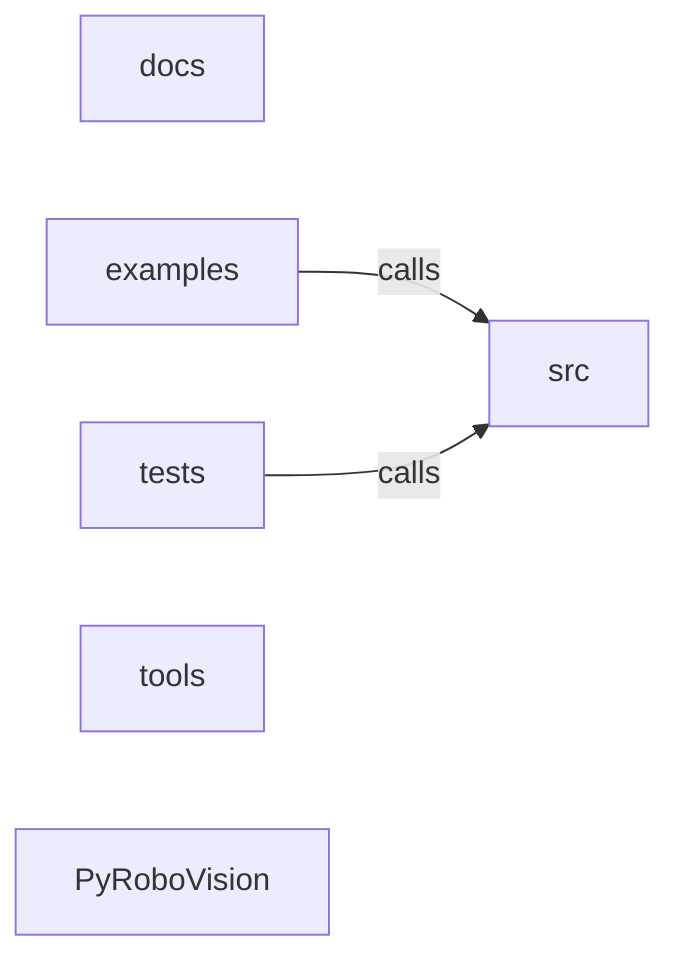

_Generated by CodeAtlas._

## Details

Architecture map of PyRoboVision.

### docs

Owns 0 symbols across 2 file(s).

**Related Classes/Methods:** _None_

### examples

Owns 7 symbols across 3 file(s).

**Related Classes/Methods:** _None_

**Source Files:**

- `examples/basic_tracking.py`
  - `examples.basic_tracking.main`
- `examples/depth_estimation.py`
  - `examples.depth_estimation.main`
  - `examples.depth_estimation.run_pipeline`
- `examples/real_detector_tracking.py`
  - `examples.real_detector_tracking._load_detector`
  - `examples.real_detector_tracking._load_sample_frames`
  - `examples.real_detector_tracking.detect`
  - `examples.real_detector_tracking.main`

### src

Owns 0 symbols across 0 file(s).

**Related Classes/Methods:** _None_

### tests

Owns 351 symbols across 23 file(s).

**Related Classes/Methods:** _None_

**Source Files:**

- `tests/test_adaptive_frame_control.py`
  - `tests.test_adaptive_frame_control._config`
  - `tests.test_adaptive_frame_control.test_decide_is_non_consuming`
  - `tests.test_adaptive_frame_control.test_downsample_is_noop_at_native_scale`
  - `tests.test_adaptive_frame_control.test_downsample_reduces_frame_shape`
  - `tests.test_adaptive_frame_control.test_high_latency_triggers_skip_and_downsample`
  - `tests.test_adaptive_frame_control.test_invalid_config_rejected`
  - `tests.test_adaptive_frame_control.test_latency_within_budget_never_skips`
  - `tests.test_adaptive_frame_control.test_negative_latency_rejected`
  - `tests.test_adaptive_frame_control.test_reset_restores_initial_state`
  - `tests.test_adaptive_frame_control.test_scale_is_bounded_by_config`
  - `tests.test_adaptive_frame_control.test_scale_recovers_after_load_subsides`
  - `tests.test_adaptive_frame_control.test_skip_count_scales_with_overshoot_and_is_capped`
  - `tests.test_adaptive_frame_control.test_starts_full_rate_and_native_scale`
  - `tests.test_adaptive_frame_control.test_target_size_tracks_scale`
- `tests/test_association.py`
  - `tests.test_association.TestObjectAssociation`
  - `tests.test_association.TestObjectAssociation.test_associate_empty_detections`
  - `tests.test_association.TestObjectAssociation.test_associate_empty_tracks`
  - `tests.test_association.TestObjectAssociation.test_associate_more_detections_than_tracks`
  - `tests.test_association.TestObjectAssociation.test_associate_more_tracks_than_detections`
  - `tests.test_association.TestObjectAssociation.test_associate_no_match`
  - `tests.test_association.TestObjectAssociation.test_associate_perfect_match`
  - `tests.test_association.TestObjectAssociation.test_build_cost_matrix_empty`
  - `tests.test_association.TestObjectAssociation.test_build_cost_matrix_single_track_detection`
  - `tests.test_association.TestObjectAssociation.test_compute_centroid_distance_different_boxes`
  - `tests.test_association.TestObjectAssociation.test_compute_centroid_distance_same_box`
  - `tests.test_association.TestObjectAssociation.test_compute_iou_identical_boxes`
  - `tests.test_association.TestObjectAssociation.test_compute_iou_no_overlap`
  - `tests.test_association.TestObjectAssociation.test_compute_iou_partial_overlap`
  - `tests.test_association.TestObjectAssociation.test_initialization`
- `tests/test_bbox_3d.py`
  - `tests.test_bbox_3d.TestBBox3D`
  - `tests.test_bbox_3d.TestBBox3D.test_get_projection_2d`
  - `tests.test_bbox_3d.TestBBox3D.test_initialization`
  - `tests.test_bbox_3d.TestBBox3D.test_intersection_over_union_identical`
  - `tests.test_bbox_3d.TestBBox3D.test_intersection_over_union_no_overlap`
  - `tests.test_bbox_3d.TestBBox3D.test_to_corners`
  - `tests.test_bbox_3d.TestBBox3D.test_volume`
  - `tests.test_bbox_3d.TestBox3DConverter`
  - `tests.test_bbox_3d.TestBox3DConverter.test_compute_iou_3d`
  - `tests.test_bbox_3d.TestBox3DConverter.test_from_2d_bbox_and_depth`
  - `tests.test_bbox_3d.TestBox3DConverter.test_from_point_cloud_empty`
  - `tests.test_bbox_3d.TestBox3DConverter.test_from_point_cloud_valid`
  - `tests.test_bbox_3d.TestBox3DConverter.test_initialization`
  - `tests.test_bbox_3d.TestBox3DConverter.test_transform_3d_bbox`
- `tests/test_behavior_analyzer.py`
  - `tests.test_behavior_analyzer.TestBehaviorAnalyzer`
  - `tests.test_behavior_analyzer.TestBehaviorAnalyzer.test_classify_accelerating`
  - `tests.test_behavior_analyzer.TestBehaviorAnalyzer.test_classify_behavior_linear`
  - `tests.test_behavior_analyzer.TestBehaviorAnalyzer.test_classify_behavior_stationary`
  - `tests.test_behavior_analyzer.TestBehaviorAnalyzer.test_classify_decelerating`
  - `tests.test_behavior_analyzer.TestBehaviorAnalyzer.test_classify_moving_straight`
  - `tests.test_behavior_analyzer.TestBehaviorAnalyzer.test_classify_stopped`
  - `tests.test_behavior_analyzer.TestBehaviorAnalyzer.test_classify_turning`
  - `tests.test_behavior_analyzer.TestBehaviorAnalyzer.test_collision_course`
  - `tests.test_behavior_analyzer.TestBehaviorAnalyzer.test_detect_lane_change`
  - `tests.test_behavior_analyzer.TestBehaviorAnalyzer.test_get_motion_pattern_duration`
  - `tests.test_behavior_analyzer.TestBehaviorAnalyzer.test_get_nonexistent_state`
  - `tests.test_behavior_analyzer.TestBehaviorAnalyzer.test_get_state`
  - `tests.test_behavior_analyzer.TestBehaviorAnalyzer.test_initialization`
  - `tests.test_behavior_analyzer.TestBehaviorAnalyzer.test_remove_track`
  - `tests.test_behavior_analyzer.TestBehaviorAnalyzer.test_reset`
  - `tests.test_behavior_analyzer.TestBehaviorAnalyzer.test_update_existing_track`
  - `tests.test_behavior_analyzer.TestBehaviorAnalyzer.test_update_new_track`
  - `tests.test_behavior_analyzer.TestExtractMotionFeatures`
  - `tests.test_behavior_analyzer.TestExtractMotionFeatures.test_constant_velocity`
  - `tests.test_behavior_analyzer.TestExtractMotionFeatures.test_empty_positions`
  - `tests.test_behavior_analyzer.TestExtractMotionFeatures.test_stationary_object`
  - `tests.test_behavior_analyzer.TestExtractMotionFeatures.test_turning_motion`
- `tests/test_behavior_cloning.py`
  - `tests.test_behavior_cloning.TestBehaviorCloningModel`
  - `tests.test_behavior_cloning.TestBehaviorCloningModel.test_evaluate`
  - `tests.test_behavior_cloning.TestBehaviorCloningModel.test_forward`
  - `tests.test_behavior_cloning.TestBehaviorCloningModel.test_get_training_statistics`
  - `tests.test_behavior_cloning.TestBehaviorCloningModel.test_initialization`
  - `tests.test_behavior_cloning.TestBehaviorCloningModel.test_predict`
  - `tests.test_behavior_cloning.TestBehaviorCloningModel.test_predict_stochastic`
  - `tests.test_behavior_cloning.TestBehaviorCloningModel.test_reset_history`
  - `tests.test_behavior_cloning.TestBehaviorCloningModel.test_train_step`
- `tests/test_codeatlas_adapter.py`
  - `tests.test_codeatlas_adapter._run`
  - `tests.test_codeatlas_adapter.test_check_reports_the_embedded_engine_available`
  - `tests.test_codeatlas_adapter.test_diagnose_summarises_the_architecture_map`
  - `tests.test_codeatlas_adapter.test_explain_reports_an_unknown_node_as_an_error`
  - `tests.test_codeatlas_adapter.test_god_nodes_are_ranked_by_degree`
- `tests/test_depth_estimation.py`
  - `tests.test_depth_estimation.TestDepthEstimator`
  - `tests.test_depth_estimation.TestDepthEstimator.test_default_model_is_heuristic`
  - `tests.test_depth_estimation.TestDepthEstimator.test_estimate_depth_grayscale`
  - `tests.test_depth_estimation.TestDepthEstimator.test_estimate_depth_rgb`
  - `tests.test_depth_estimation.TestDepthEstimator.test_estimate_uncertainty`
  - `tests.test_depth_estimation.TestDepthEstimator.test_fuse_with_lidar`
  - `tests.test_depth_estimation.TestDepthEstimator.test_invalid_model_rejected`
  - `tests.test_depth_estimation.TestDepthEstimator.test_midas_missing_torch_raises_clear_actionable_error`
  - `tests.test_depth_estimation.TestDepthEstimator.test_midas_missing_torch_raises_clear_actionable_error._blocked_import`
  - `tests.test_depth_estimation.TestDepthEstimator.test_midas_real_inference_sanity`
  - `tests.test_depth_estimation.TestDepthEstimator.test_set_calibration`
  - `tests.test_depth_estimation.TestDepthMap`
  - `tests.test_depth_estimation.TestDepthMap.test_downsample`
  - `tests.test_depth_estimation.TestDepthMap.test_get_depth_batch`
  - `tests.test_depth_estimation.TestDepthMap.test_get_depth_invalid`
  - `tests.test_depth_estimation.TestDepthMap.test_get_depth_valid`
  - `tests.test_depth_estimation.TestDepthMap.test_initialization`
  - `tests.test_depth_estimation.TestDepthMap.test_to_3d`
  - `tests.test_depth_estimation.TestDepthMap.test_upsample`
- `tests/test_imitation_learning.py`
  - `tests.test_imitation_learning.TestDemonstrationDataset`
  - `tests.test_imitation_learning.TestDemonstrationDataset.test_augment_with_noise`
  - `tests.test_imitation_learning.TestDemonstrationDataset.test_get_statistics`
  - `tests.test_imitation_learning.TestDemonstrationDataset.test_initialization`
  - `tests.test_imitation_learning.TestDemonstrationDataset.test_normalize_observations`
  - `tests.test_imitation_learning.TestDemonstrationDataset.test_train_test_split`
  - `tests.test_imitation_learning.TestImitationLearner`
  - `tests.test_imitation_learning.TestImitationLearner.test_get_dataset`
  - `tests.test_imitation_learning.TestImitationLearner.test_get_statistics`
  - `tests.test_imitation_learning.TestImitationLearner.test_initialization`
  - `tests.test_imitation_learning.TestImitationLearner.test_record_episode`
  - `tests.test_imitation_learning.TestImitationLearner.test_record_transition`
  - `tests.test_imitation_learning.TestImitationLearner.test_sample_batch`
  - `tests.test_imitation_learning.TestImitationLearner.test_sample_trajectory`
  - `tests.test_imitation_learning.TestTransition`
  - `tests.test_imitation_learning.TestTransition.test_initialization`
- `tests/test_intent_predictor.py`
  - `tests.test_intent_predictor.TestIntentPredictor`
  - `tests.test_intent_predictor.TestIntentPredictor.test_collision_confidence_bounds`
  - `tests.test_intent_predictor.TestIntentPredictor.test_confidence_bounds`
  - `tests.test_intent_predictor.TestIntentPredictor.test_estimate_evasion_trajectory_danger`
  - `tests.test_intent_predictor.TestIntentPredictor.test_estimate_evasion_trajectory_safe_distance`
  - `tests.test_intent_predictor.TestIntentPredictor.test_initialization`
  - `tests.test_intent_predictor.TestIntentPredictor.test_predict_collision_intent_collision`
  - `tests.test_intent_predictor.TestIntentPredictor.test_predict_collision_intent_no_collision`
  - `tests.test_intent_predictor.TestIntentPredictor.test_predict_intent_accelerating`
  - `tests.test_intent_predictor.TestIntentPredictor.test_predict_intent_continue`
  - `tests.test_intent_predictor.TestIntentPredictor.test_predict_intent_decelerating`
  - `tests.test_intent_predictor.TestIntentPredictor.test_predict_intent_insufficient_history`
  - `tests.test_intent_predictor.TestIntentPredictor.test_predict_intent_stationary`
  - `tests.test_intent_predictor.TestIntentPredictor.test_predict_intent_turn_left`
  - `tests.test_intent_predictor.TestIntentPredictor.test_predict_intent_turn_right`
  - `tests.test_intent_predictor.TestIntentPredictor.test_predict_multiple_intents_accelerating`
  - `tests.test_intent_predictor.TestIntentPredictor.test_predict_multiple_intents_stationary`
  - `tests.test_intent_predictor.TestIntentPredictor.test_predicted_position`
  - `tests.test_intent_predictor.TestIntentPredictor.test_reasoning_generation`
- `tests/test_kalman_filter.py`
  - `tests.test_kalman_filter.TestKalmanFilter`
  - `tests.test_kalman_filter.TestKalmanFilter.test_constant_velocity_prediction`
  - `tests.test_kalman_filter.TestKalmanFilter.test_get_set_state`
  - `tests.test_kalman_filter.TestKalmanFilter.test_initialization`
  - `tests.test_kalman_filter.TestKalmanFilter.test_initialize_state`
  - `tests.test_kalman_filter.TestKalmanFilter.test_mahalanobis_distance`
  - `tests.test_kalman_filter.TestKalmanFilter.test_predict`
  - `tests.test_kalman_filter.TestKalmanFilter.test_predict_with_different_dt`
  - `tests.test_kalman_filter.TestKalmanFilter.test_update`
- `tests/test_lidar_processor.py`
  - `tests.test_lidar_processor.TestLiDARProcessor`
  - `tests.test_lidar_processor.TestLiDARProcessor.test_cluster_points_empty`
  - `tests.test_lidar_processor.TestLiDARProcessor.test_cluster_points_multiple_clusters`
  - `tests.test_lidar_processor.TestLiDARProcessor.test_cluster_points_single_cluster`
  - `tests.test_lidar_processor.TestLiDARProcessor.test_compute_normals`
  - `tests.test_lidar_processor.TestLiDARProcessor.test_initialization`
  - `tests.test_lidar_processor.TestLiDARProcessor.test_process_raw`
  - `tests.test_lidar_processor.TestLiDARProcessor.test_remove_ground`
  - `tests.test_lidar_processor.TestLiDARProcessor.test_transform_points`
  - `tests.test_lidar_processor.TestPointCloud`
  - `tests.test_lidar_processor.TestPointCloud.test_downsample`
  - `tests.test_lidar_processor.TestPointCloud.test_filter_by_height`
  - `tests.test_lidar_processor.TestPointCloud.test_filter_by_range_empty`
  - `tests.test_lidar_processor.TestPointCloud.test_filter_by_range_valid`
  - `tests.test_lidar_processor.TestPointCloud.test_get_statistics`
  - `tests.test_lidar_processor.TestPointCloud.test_initialization`
  - `tests.test_lidar_processor.TestPointCloud.test_voxelize`
  - `tests.test_lidar_processor.TestPointCloud.test_with_intensities`
- `tests/test_model_optimization.py`
  - `tests.test_model_optimization.TestModelOptimizer`
  - `tests.test_model_optimization.TestModelOptimizer.test_compare_inference_speed`
  - `tests.test_model_optimization.TestModelOptimizer.test_compare_inference_speed_no_improvement`
  - `tests.test_model_optimization.TestModelOptimizer.test_compare_inference_speed_slightly_worse`
  - `tests.test_model_optimization.TestModelOptimizer.test_get_optimization_report`
  - `tests.test_model_optimization.TestModelOptimizer.test_initialization`
  - `tests.test_model_optimization.TestModelOptimizer.test_initialization_with_model`
  - `tests.test_model_optimization.TestModelOptimizer.test_initialization_with_model.DummyModel`
  - `tests.test_model_optimization.TestModelOptimizer.test_initialization_with_model.DummyModel.__call__`
  - `tests.test_model_optimization.TestModelOptimizer.test_quantization_config_creation`
  - `tests.test_model_optimization.TestQuantizationConfig`
  - `tests.test_model_optimization.TestQuantizationConfig.test_default_config`
  - `tests.test_model_optimization.TestQuantizationConfig.test_initialization`
- `tests/test_mot_tracker.py`
  - `tests.test_mot_tracker.TestMOTTracker`
  - `tests.test_mot_tracker.TestMOTTracker.test_mot_confirm_track`
  - `tests.test_mot_tracker.TestMOTTracker.test_mot_detection_object_initialization`
  - `tests.test_mot_tracker.TestMOTTracker.test_mot_detection_with_features`
  - `tests.test_mot_tracker.TestMOTTracker.test_mot_frame_counter`
  - `tests.test_mot_tracker.TestMOTTracker.test_mot_get_track_by_id`
  - `tests.test_mot_tracker.TestMOTTracker.test_mot_initialization`
  - `tests.test_mot_tracker.TestMOTTracker.test_mot_multiple_detections`
  - `tests.test_mot_tracker.TestMOTTracker.test_mot_reset`
  - `tests.test_mot_tracker.TestMOTTracker.test_mot_single_detection`
  - `tests.test_mot_tracker.TestMOTTracker.test_mot_statistics`
  - `tests.test_mot_tracker.TestMOTTracker.test_mot_track_age_increment`
  - `tests.test_mot_tracker.TestMOTTracker.test_mot_track_persistence`
  - `tests.test_mot_tracker.TestMOTTracker.test_mot_track_removal_on_max_age`
  - `tests.test_mot_tracker.TestMOTTracker.test_mot_unmatched_detections_create_new_tracks`
  - `tests.test_mot_tracker.TestTrack`
  - `tests.test_mot_tracker.TestTrack.test_track_confirmation`
  - `tests.test_mot_tracker.TestTrack.test_track_get_bbox_from_detection`
  - `tests.test_mot_tracker.TestTrack.test_track_get_position`
  - `tests.test_mot_tracker.TestTrack.test_track_get_velocity`
  - `tests.test_mot_tracker.TestTrack.test_track_initialization`
  - `tests.test_mot_tracker.TestTrack.test_track_is_alive`
  - `tests.test_mot_tracker.TestTrack.test_track_predict`
  - `tests.test_mot_tracker.TestTrack.test_track_update`
- `tests/test_occlusion.py`
  - `tests.test_occlusion.TestMultiObjectOcclusion`
  - `tests.test_occlusion.TestMultiObjectOcclusion.test_one_object_occluded_does_not_disturb_other_tracked_object`
  - `tests.test_occlusion.TestOcclusionSurvival`
  - `tests.test_occlusion.TestOcclusionSurvival.test_track_is_predicted_forward_during_occlusion`
  - `tests.test_occlusion.TestOcclusionSurvival.test_track_remains_confirmed_and_reportable_during_occlusion`
  - `tests.test_occlusion.TestOcclusionSurvival.test_track_survives_short_occlusion_gap`
  - `tests.test_occlusion.TestReacquisitionAfterOcclusion`
  - `tests.test_occlusion.TestReacquisitionAfterOcclusion.test_occlusion_beyond_max_age_kills_track_and_next_sighting_is_new_id`
  - `tests.test_occlusion.TestReacquisitionAfterOcclusion.test_reacquires_same_track_id_after_brief_occlusion`
  - `tests.test_occlusion.TestReacquisitionAfterOcclusion.test_time_since_update_resets_after_reacquisition`
  - `tests.test_occlusion._confirm_track`
- `tests/test_occupancy_grid.py`
  - `tests.test_occupancy_grid.TestOccupancyGrid`
  - `tests.test_occupancy_grid.TestOccupancyGrid.test_dilate`
  - `tests.test_occupancy_grid.TestOccupancyGrid.test_erode`
  - `tests.test_occupancy_grid.TestOccupancyGrid.test_get_connectivity_map`
  - `tests.test_occupancy_grid.TestOccupancyGrid.test_get_occupancy`
  - `tests.test_occupancy_grid.TestOccupancyGrid.test_get_occupied_cells`
  - `tests.test_occupancy_grid.TestOccupancyGrid.test_grid_to_world`
  - `tests.test_occupancy_grid.TestOccupancyGrid.test_initialization`
  - `tests.test_occupancy_grid.TestOccupancyGrid.test_set_occupied`
  - `tests.test_occupancy_grid.TestOccupancyGrid.test_world_to_grid`
  - `tests.test_occupancy_grid.TestOccupancyGridBuilder`
  - `tests.test_occupancy_grid.TestOccupancyGridBuilder.test_from_3d_bboxes`
  - `tests.test_occupancy_grid.TestOccupancyGridBuilder.test_from_point_cloud_empty`
  - `tests.test_occupancy_grid.TestOccupancyGridBuilder.test_from_point_cloud_valid`
  - `tests.test_occupancy_grid.TestOccupancyGridBuilder.test_initialization`
  - `tests.test_occupancy_grid.TestOccupancyGridBuilder.test_merge_grids`
- `tests/test_policy_safety.py`
  - `tests.test_policy_safety.TestConstraintChecker`
  - `tests.test_policy_safety.TestConstraintChecker.test_check_all_constraints`
  - `tests.test_policy_safety.TestConstraintChecker.test_check_constraint_satisfied`
  - `tests.test_policy_safety.TestConstraintChecker.test_check_constraint_violated`
  - `tests.test_policy_safety.TestConstraintChecker.test_initialization`
  - `tests.test_policy_safety.TestConstraintChecker.test_register_constraint`
  - `tests.test_policy_safety.TestPolicyNetwork`
  - `tests.test_policy_safety.TestPolicyNetwork.test_compute_log_probs`
  - `tests.test_policy_safety.TestPolicyNetwork.test_forward_policy`
  - `tests.test_policy_safety.TestPolicyNetwork.test_forward_value`
  - `tests.test_policy_safety.TestPolicyNetwork.test_initialization`
  - `tests.test_policy_safety.TestPolicyNetwork.test_sample_action_deterministic`
  - `tests.test_policy_safety.TestPolicyNetwork.test_sample_action_stochastic`
  - `tests.test_policy_safety.TestPolicyOptimizer`
  - `tests.test_policy_safety.TestPolicyOptimizer.test_compute_gae`
  - `tests.test_policy_safety.TestPolicyOptimizer.test_get_statistics`
  - `tests.test_policy_safety.TestPolicyOptimizer.test_initialization`
  - `tests.test_policy_safety.TestPolicyOptimizer.test_update`
  - `tests.test_policy_safety.TestSafetyValidator`
  - `tests.test_policy_safety.TestSafetyValidator.test_correct_action`
  - `tests.test_policy_safety.TestSafetyValidator.test_get_safety_metrics`
  - `tests.test_policy_safety.TestSafetyValidator.test_initialization`
  - `tests.test_policy_safety.TestSafetyValidator.test_validate_action_safe`
  - `tests.test_policy_safety.TestSafetyValidator.test_validate_action_unsafe_acceleration`
- `tests/test_sensor_fusion.py`
  - `tests.test_sensor_fusion.TestGPSData`
  - `tests.test_sensor_fusion.TestGPSData.test_initialization`
  - `tests.test_sensor_fusion.TestIMUData`
  - `tests.test_sensor_fusion.TestIMUData.test_initialization`
  - `tests.test_sensor_fusion.TestSensorFusionEngine`
  - `tests.test_sensor_fusion.TestSensorFusionEngine.test_get_covariance`
  - `tests.test_sensor_fusion.TestSensorFusionEngine.test_get_state_vector`
  - `tests.test_sensor_fusion.TestSensorFusionEngine.test_get_statistics`
  - `tests.test_sensor_fusion.TestSensorFusionEngine.test_gps_speed_update`
  - `tests.test_sensor_fusion.TestSensorFusionEngine.test_gps_to_local`
  - `tests.test_sensor_fusion.TestSensorFusionEngine.test_initialization`
  - `tests.test_sensor_fusion.TestSensorFusionEngine.test_multi_sensor_fusion`
  - `tests.test_sensor_fusion.TestSensorFusionEngine.test_reset`
  - `tests.test_sensor_fusion.TestSensorFusionEngine.test_update_gps`
  - `tests.test_sensor_fusion.TestSensorFusionEngine.test_update_imu`
  - `tests.test_sensor_fusion.TestSensorFusionEngine.test_update_imu_sequence`
- `tests/test_training.py`
  - `tests.test_training.TestTrainer`
  - `tests.test_training.TestTrainer.test_get_training_summary`
  - `tests.test_training.TestTrainer.test_initialization`
  - `tests.test_training.TestTrainer.test_plot_training_curve`
  - `tests.test_training.TestTrainer.test_train`
  - `tests.test_training.TestTrainer.test_train_epoch`
  - `tests.test_training.TestTrainer.test_validate`
  - `tests.test_training.TestTrainingConfig`
  - `tests.test_training.TestTrainingConfig.test_initialization`
  - `tests.test_training.TestTrainingConfig.test_save_and_load`
  - `tests.test_training.TestTrainingConfig.test_to_dict`
- `tests/test_trajectory_prediction.py`
  - `tests.test_trajectory_prediction.TestConstantAccelerationModel`
  - `tests.test_trajectory_prediction.TestConstantAccelerationModel.test_predict_trajectory`
  - `tests.test_trajectory_prediction.TestConstantAccelerationModel.test_predict_trajectory_with_two_positions`
  - `tests.test_trajectory_prediction.TestConstantAccelerationModel.test_predict_with_constant_acceleration`
  - `tests.test_trajectory_prediction.TestConstantAccelerationModel.test_predict_with_insufficient_history`
  - `tests.test_trajectory_prediction.TestConstantVelocityModel`
  - `tests.test_trajectory_prediction.TestConstantVelocityModel.test_predict_trajectory`
  - `tests.test_trajectory_prediction.TestConstantVelocityModel.test_predict_trajectory_with_single_position`
  - `tests.test_trajectory_prediction.TestConstantVelocityModel.test_predict_with_single_position`
  - `tests.test_trajectory_prediction.TestConstantVelocityModel.test_predict_with_two_positions`
  - `tests.test_trajectory_prediction.TestConstantVelocityModel.test_predict_with_velocity`
  - `tests.test_trajectory_prediction.TestLearnedTrajectoryModel`
  - `tests.test_trajectory_prediction.TestLearnedTrajectoryModel.test_fit_reduces_loss`
  - `tests.test_trajectory_prediction.TestLearnedTrajectoryModel.test_fit_with_insufficient_history_raises`
  - `tests.test_trajectory_prediction.TestLearnedTrajectoryModel.test_generalizes_better_than_constant_velocity_on_curved_motion`
  - `tests.test_trajectory_prediction.TestLearnedTrajectoryModel.test_missing_torch_raises_clear_actionable_error`
  - `tests.test_trajectory_prediction.TestLearnedTrajectoryModel.test_missing_torch_raises_clear_actionable_error.fake_import`
  - `tests.test_trajectory_prediction.TestLearnedTrajectoryModel.test_predict_before_fit_raises`
  - `tests.test_trajectory_prediction.TestLearnedTrajectoryModel.test_predict_trajectory_shape`
  - `tests.test_trajectory_prediction.TestTrajectoryPredictor`
  - `tests.test_trajectory_prediction.TestTrajectoryPredictor.test_compute_average_displacement_error`
  - `tests.test_trajectory_prediction.TestTrajectoryPredictor.test_compute_average_displacement_error_perfect`
  - `tests.test_trajectory_prediction.TestTrajectoryPredictor.test_compute_final_displacement_error`
  - `tests.test_trajectory_prediction.TestTrajectoryPredictor.test_compute_final_displacement_error_empty`
  - `tests.test_trajectory_prediction.TestTrajectoryPredictor.test_compute_final_displacement_error_perfect`
  - `tests.test_trajectory_prediction.TestTrajectoryPredictor.test_initialization_ca`
  - `tests.test_trajectory_prediction.TestTrajectoryPredictor.test_initialization_cv`
  - `tests.test_trajectory_prediction.TestTrajectoryPredictor.test_initialization_learned`
  - `tests.test_trajectory_prediction.TestTrajectoryPredictor.test_predict_next`
  - `tests.test_trajectory_prediction.TestTrajectoryPredictor.test_predict_trajectory_ca`
  - `tests.test_trajectory_prediction.TestTrajectoryPredictor.test_predict_trajectory_cv`
  - `tests.test_trajectory_prediction.TestTrajectoryPredictor.test_unknown_model_raises`
  - `tests.test_trajectory_prediction.TestTrajectoryPredictor.test_update`
  - `tests.test_trajectory_prediction._circular_trajectory`
- `tests/test_uncertainty.py`
  - `tests.test_uncertainty.TestUncertaintyEstimator`
  - `tests.test_uncertainty.TestUncertaintyEstimator.test_compute_confidence_ellipse`
  - `tests.test_uncertainty.TestUncertaintyEstimator.test_compute_confidence_ellipse_identity`
  - `tests.test_uncertainty.TestUncertaintyEstimator.test_estimate_position_uncertainty_single_position`
  - `tests.test_uncertainty.TestUncertaintyEstimator.test_estimate_position_uncertainty_three_positions`
  - `tests.test_uncertainty.TestUncertaintyEstimator.test_estimate_position_uncertainty_two_positions`
  - `tests.test_uncertainty.TestUncertaintyEstimator.test_estimate_trajectory_uncertainty`
  - `tests.test_uncertainty.TestUncertaintyEstimator.test_estimate_trajectory_uncertainty_single`
  - `tests.test_uncertainty.TestUncertaintyEstimator.test_estimate_velocity_uncertainty_constant`
  - `tests.test_uncertainty.TestUncertaintyEstimator.test_estimate_velocity_uncertainty_single`
  - `tests.test_uncertainty.TestUncertaintyEstimator.test_estimate_velocity_uncertainty_varying`
  - `tests.test_uncertainty.TestUncertaintyEstimator.test_initialization`
  - `tests.test_uncertainty.TestUncertaintyEstimator.test_predict_with_uncertainty`
  - `tests.test_uncertainty.TestUncertaintyEstimator.test_predict_with_uncertainty_increasing`
- `tests/test_v1_2_integration.py`
  - `tests.test_v1_2_integration.TestV12Integration`
  - `tests.test_v1_2_integration.TestV12Integration.test_behavior_and_intent_consistency`
  - `tests.test_v1_2_integration.TestV12Integration.test_collision_detection_with_tracking`
  - `tests.test_v1_2_integration.TestV12Integration.test_end_to_end_scenario`
  - `tests.test_v1_2_integration.TestV12Integration.test_full_tracking_pipeline`
  - `tests.test_v1_2_integration.TestV12Integration.test_multiple_object_tracking_with_prediction`
  - `tests.test_v1_2_integration.TestV12Integration.test_track_lifecycle`
  - `tests.test_v1_2_integration.TestV12Integration.test_trajectory_prediction_accuracy`
  - `tests.test_v1_2_integration.TestV12Integration.test_uncertainty_propagation`
- `tests/test_v1_5_integration.py`
  - `tests.test_v1_5_integration.TestV15Integration`
  - `tests.test_v1_5_integration.TestV15Integration.test_3d_bbox_to_occupancy`
  - `tests.test_v1_5_integration.TestV15Integration.test_depth_lidar_fusion`
  - `tests.test_v1_5_integration.TestV15Integration.test_depth_uncertainty_map`
  - `tests.test_v1_5_integration.TestV15Integration.test_full_3d_perception_pipeline`
  - `tests.test_v1_5_integration.TestV15Integration.test_lidar_ground_removal_and_clustering`
  - `tests.test_v1_5_integration.TestV15Integration.test_lidar_point_cloud_to_occupancy`
  - `tests.test_v1_5_integration.TestV15Integration.test_monocular_depth_to_3d_bbox`
  - `tests.test_v1_5_integration.TestV15Integration.test_multiple_3d_bboxes_iou`
  - `tests.test_v1_5_integration.TestV15Integration.test_occupancy_grid_morphology`
- `tests/test_v2_0_integration.py`
  - `tests.test_v2_0_integration.TestV20Integration`
  - `tests.test_v2_0_integration.TestV20Integration.test_behavior_cloning_with_augmentation`
  - `tests.test_v2_0_integration.TestV20Integration.test_end_to_end_training_scenario`
  - `tests.test_v2_0_integration.TestV20Integration.test_full_learning_pipeline`
  - `tests.test_v2_0_integration.TestV20Integration.test_imitation_to_behavior_cloning`
  - `tests.test_v2_0_integration.TestV20Integration.test_multi_episode_learning`
  - `tests.test_v2_0_integration.TestV20Integration.test_policy_learning_with_safety`
  - `tests.test_v2_0_integration.TestV20Integration.test_safety_validation_throughout_learning`

### tools

Owns 0 symbols across 0 file(s).

**Related Classes/Methods:** _None_

### PyRoboVision

Owns 0 symbols across 10 file(s).

**Related Classes/Methods:** _None_
