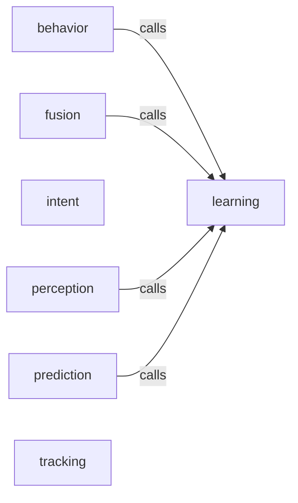

_Generated by CodeAtlas._

## Details

Owns 0 symbols across 2 file(s).

### behavior

Owns 17 symbols across 3 file(s).

**Related Classes/Methods:** _None_

**Source Files:**

- `src/pyrobovision/behavior/analyzer.py`
  - `src.pyrobovision.behavior.analyzer.BehaviorAnalyzer`
  - `src.pyrobovision.behavior.analyzer.BehaviorAnalyzer.__init__`
  - `src.pyrobovision.behavior.analyzer.BehaviorAnalyzer.classify_behavior_pattern`
  - `src.pyrobovision.behavior.analyzer.BehaviorAnalyzer.classify_motion_pattern`
  - `src.pyrobovision.behavior.analyzer.BehaviorAnalyzer.detect_lane_change`
  - `src.pyrobovision.behavior.analyzer.BehaviorAnalyzer.get_all_states`
  - `src.pyrobovision.behavior.analyzer.BehaviorAnalyzer.get_motion_pattern_duration`
  - `src.pyrobovision.behavior.analyzer.BehaviorAnalyzer.get_state`
  - `src.pyrobovision.behavior.analyzer.BehaviorAnalyzer.is_collision_course`
  - `src.pyrobovision.behavior.analyzer.BehaviorAnalyzer.remove_track`
  - `src.pyrobovision.behavior.analyzer.BehaviorAnalyzer.reset`
  - `src.pyrobovision.behavior.analyzer.BehaviorAnalyzer.update`
  - `src.pyrobovision.behavior.analyzer.BehaviorState`
- `src/pyrobovision/behavior/patterns.py`
  - `src.pyrobovision.behavior.patterns.BehaviorPattern`
  - `src.pyrobovision.behavior.patterns.MotionClassification`
  - `src.pyrobovision.behavior.patterns.MotionPattern`
  - `src.pyrobovision.behavior.patterns.extract_motion_features`

### fusion

Owns 23 symbols across 3 file(s).

**Related Classes/Methods:** _None_

**Source Files:**

- `src/pyrobovision/fusion/optimization.py`
  - `src.pyrobovision.fusion.optimization.ModelOptimizer`
  - `src.pyrobovision.fusion.optimization.ModelOptimizer.__init__`
  - `src.pyrobovision.fusion.optimization.ModelOptimizer.compare_inference_speed`
  - `src.pyrobovision.fusion.optimization.ModelOptimizer.estimate_memory`
  - `src.pyrobovision.fusion.optimization.ModelOptimizer.export_to_onnx`
  - `src.pyrobovision.fusion.optimization.ModelOptimizer.export_to_tensorrt`
  - `src.pyrobovision.fusion.optimization.ModelOptimizer.get_optimization_report`
  - `src.pyrobovision.fusion.optimization.ModelOptimizer.profile_inference`
  - `src.pyrobovision.fusion.optimization.ModelOptimizer.quantize_model`
  - `src.pyrobovision.fusion.optimization.QuantizationConfig`
- `src/pyrobovision/fusion/sensor_fusion.py`
  - `src.pyrobovision.fusion.sensor_fusion.FusionState`
  - `src.pyrobovision.fusion.sensor_fusion.GPSData`
  - `src.pyrobovision.fusion.sensor_fusion.IMUData`
  - `src.pyrobovision.fusion.sensor_fusion.SensorFusionEngine`
  - `src.pyrobovision.fusion.sensor_fusion.SensorFusionEngine.__init__`
  - `src.pyrobovision.fusion.sensor_fusion.SensorFusionEngine._gps_to_local`
  - `src.pyrobovision.fusion.sensor_fusion.SensorFusionEngine._rotation_matrix_from_euler`
  - `src.pyrobovision.fusion.sensor_fusion.SensorFusionEngine.get_covariance`
  - `src.pyrobovision.fusion.sensor_fusion.SensorFusionEngine.get_state_vector`
  - `src.pyrobovision.fusion.sensor_fusion.SensorFusionEngine.get_statistics`
  - `src.pyrobovision.fusion.sensor_fusion.SensorFusionEngine.reset`
  - `src.pyrobovision.fusion.sensor_fusion.SensorFusionEngine.update_gps`
  - `src.pyrobovision.fusion.sensor_fusion.SensorFusionEngine.update_imu`

### intent

Owns 10 symbols across 2 file(s).

**Related Classes/Methods:** _None_

**Source Files:**

- `src/pyrobovision/intent/predictor.py`
  - `src.pyrobovision.intent.predictor.Intent`
  - `src.pyrobovision.intent.predictor.IntentPrediction`
  - `src.pyrobovision.intent.predictor.IntentPredictor`
  - `src.pyrobovision.intent.predictor.IntentPredictor.__init__`
  - `src.pyrobovision.intent.predictor.IntentPredictor._generate_reasoning`
  - `src.pyrobovision.intent.predictor.IntentPredictor._predict_stationary`
  - `src.pyrobovision.intent.predictor.IntentPredictor.estimate_evasion_trajectory`
  - `src.pyrobovision.intent.predictor.IntentPredictor.predict_collision_intent`
  - `src.pyrobovision.intent.predictor.IntentPredictor.predict_intent`
  - `src.pyrobovision.intent.predictor.IntentPredictor.predict_multiple_intents`

### learning

Owns 73 symbols across 6 file(s).

**Related Classes/Methods:** _None_

**Source Files:**

- `src/pyrobovision/learning/behavior_cloning.py`
  - `src.pyrobovision.learning.behavior_cloning.BCLoss`
  - `src.pyrobovision.learning.behavior_cloning.BCLoss.__str__`
  - `src.pyrobovision.learning.behavior_cloning.BehaviorCloningModel`
  - `src.pyrobovision.learning.behavior_cloning.BehaviorCloningModel.__init__`
  - `src.pyrobovision.learning.behavior_cloning.BehaviorCloningModel._compute_kl_divergence`
  - `src.pyrobovision.learning.behavior_cloning.BehaviorCloningModel._initialize_network`
  - `src.pyrobovision.learning.behavior_cloning.BehaviorCloningModel.backward`
  - `src.pyrobovision.learning.behavior_cloning.BehaviorCloningModel.evaluate`
  - `src.pyrobovision.learning.behavior_cloning.BehaviorCloningModel.forward`
  - `src.pyrobovision.learning.behavior_cloning.BehaviorCloningModel.get_training_statistics`
  - `src.pyrobovision.learning.behavior_cloning.BehaviorCloningModel.predict`
  - `src.pyrobovision.learning.behavior_cloning.BehaviorCloningModel.reset_history`
  - `src.pyrobovision.learning.behavior_cloning.BehaviorCloningModel.train_step`
- `src/pyrobovision/learning/imitation.py`
  - `src.pyrobovision.learning.imitation.DemonstrationDataset`
  - `src.pyrobovision.learning.imitation.DemonstrationDataset.__getitem__`
  - `src.pyrobovision.learning.imitation.DemonstrationDataset.__len__`
  - `src.pyrobovision.learning.imitation.DemonstrationDataset.augment_with_noise`
  - `src.pyrobovision.learning.imitation.DemonstrationDataset.get_episode`
  - `src.pyrobovision.learning.imitation.DemonstrationDataset.get_statistics`
  - `src.pyrobovision.learning.imitation.DemonstrationDataset.normalize_observations`
  - `src.pyrobovision.learning.imitation.DemonstrationDataset.train_test_split`
  - `src.pyrobovision.learning.imitation.ImitationLearner`
  - `src.pyrobovision.learning.imitation.ImitationLearner.__init__`
  - `src.pyrobovision.learning.imitation.ImitationLearner.clear`
  - `src.pyrobovision.learning.imitation.ImitationLearner.get_dataset`
  - `src.pyrobovision.learning.imitation.ImitationLearner.get_statistics`
  - `src.pyrobovision.learning.imitation.ImitationLearner.record_transition`
  - `src.pyrobovision.learning.imitation.ImitationLearner.sample_batch`
  - `src.pyrobovision.learning.imitation.ImitationLearner.sample_trajectory`
  - `src.pyrobovision.learning.imitation.Transition`
  - `src.pyrobovision.learning.imitation.Transition.__post_init__`
- `src/pyrobovision/learning/policy.py`
  - `src.pyrobovision.learning.policy.PolicyNetwork`
  - `src.pyrobovision.learning.policy.PolicyNetwork.__init__`
  - `src.pyrobovision.learning.policy.PolicyNetwork._initialize_networks`
  - `src.pyrobovision.learning.policy.PolicyNetwork.compute_log_probs`
  - `src.pyrobovision.learning.policy.PolicyNetwork.forward_policy`
  - `src.pyrobovision.learning.policy.PolicyNetwork.forward_value`
  - `src.pyrobovision.learning.policy.PolicyNetwork.sample_action`
  - `src.pyrobovision.learning.policy.PolicyNetwork.update_std`
  - `src.pyrobovision.learning.policy.PolicyOptimizer`
  - `src.pyrobovision.learning.policy.PolicyOptimizer.__init__`
  - `src.pyrobovision.learning.policy.PolicyOptimizer.compute_gae`
  - `src.pyrobovision.learning.policy.PolicyOptimizer.get_statistics`
  - `src.pyrobovision.learning.policy.PolicyOptimizer.update`
  - `src.pyrobovision.learning.policy.PolicyState`
- `src/pyrobovision/learning/safety.py`
  - `src.pyrobovision.learning.safety.ConstraintChecker`
  - `src.pyrobovision.learning.safety.ConstraintChecker.__init__`
  - `src.pyrobovision.learning.safety.ConstraintChecker.check_all_constraints`
  - `src.pyrobovision.learning.safety.ConstraintChecker.check_constraint`
  - `src.pyrobovision.learning.safety.ConstraintChecker.clear_history`
  - `src.pyrobovision.learning.safety.ConstraintChecker.get_statistics`
  - `src.pyrobovision.learning.safety.ConstraintChecker.register_constraint`
  - `src.pyrobovision.learning.safety.SafetyValidator`
  - `src.pyrobovision.learning.safety.SafetyValidator.__init__`
  - `src.pyrobovision.learning.safety.SafetyValidator._register_default_constraints`
  - `src.pyrobovision.learning.safety.SafetyValidator.correct_action`
  - `src.pyrobovision.learning.safety.SafetyValidator.get_safety_metrics`
  - `src.pyrobovision.learning.safety.SafetyValidator.validate_action`
  - `src.pyrobovision.learning.safety.SafetyValidator.validate_trajectory`
  - `src.pyrobovision.learning.safety.SafetyViolation`
  - `src.pyrobovision.learning.safety.SafetyViolation.__str__`
- `src/pyrobovision/learning/training.py`
  - `src.pyrobovision.learning.training.Trainer`
  - `src.pyrobovision.learning.training.Trainer.__init__`
  - `src.pyrobovision.learning.training.Trainer.get_training_summary`
  - `src.pyrobovision.learning.training.Trainer.plot_training_curve`
  - `src.pyrobovision.learning.training.Trainer.train`
  - `src.pyrobovision.learning.training.Trainer.train_epoch`
  - `src.pyrobovision.learning.training.Trainer.validate`
  - `src.pyrobovision.learning.training.TrainingConfig`
  - `src.pyrobovision.learning.training.TrainingConfig.__post_init__`
  - `src.pyrobovision.learning.training.TrainingConfig.load`
  - `src.pyrobovision.learning.training.TrainingConfig.save`
  - `src.pyrobovision.learning.training.TrainingConfig.to_dict`

### perception

Owns 77 symbols across 6 file(s).

**Related Classes/Methods:** _None_

**Source Files:**

- `src/pyrobovision/perception/adaptive.py`
  - `src.pyrobovision.perception.adaptive.AdaptiveFrameConfig`
  - `src.pyrobovision.perception.adaptive.AdaptiveFrameConfig.__post_init__`
  - `src.pyrobovision.perception.adaptive.AdaptiveFrameController`
  - `src.pyrobovision.perception.adaptive.AdaptiveFrameController.__init__`
  - `src.pyrobovision.perception.adaptive.AdaptiveFrameController._apply_backpressure`
  - `src.pyrobovision.perception.adaptive.AdaptiveFrameController._relax`
  - `src.pyrobovision.perception.adaptive.AdaptiveFrameController.decide`
  - `src.pyrobovision.perception.adaptive.AdaptiveFrameController.downsample`
  - `src.pyrobovision.perception.adaptive.AdaptiveFrameController.effective_fps`
  - `src.pyrobovision.perception.adaptive.AdaptiveFrameController.latency_ms`
  - `src.pyrobovision.perception.adaptive.AdaptiveFrameController.observe`
  - `src.pyrobovision.perception.adaptive.AdaptiveFrameController.reset`
  - `src.pyrobovision.perception.adaptive.AdaptiveFrameController.scale`
  - `src.pyrobovision.perception.adaptive.AdaptiveFrameController.should_process`
  - `src.pyrobovision.perception.adaptive.AdaptiveFrameController.target_size`
  - `src.pyrobovision.perception.adaptive.FrameDecision`
- `src/pyrobovision/perception/bbox_3d.py`
  - `src.pyrobovision.perception.bbox_3d.BBox3D`
  - `src.pyrobovision.perception.bbox_3d.BBox3D.get_projection_2d`
  - `src.pyrobovision.perception.bbox_3d.BBox3D.intersection_over_union`
  - `src.pyrobovision.perception.bbox_3d.BBox3D.to_corners`
  - `src.pyrobovision.perception.bbox_3d.BBox3D.volume`
  - `src.pyrobovision.perception.bbox_3d.Box3DConverter`
  - `src.pyrobovision.perception.bbox_3d.Box3DConverter.__init__`
  - `src.pyrobovision.perception.bbox_3d.Box3DConverter._compute_pca`
  - `src.pyrobovision.perception.bbox_3d.Box3DConverter.compute_iou_3d`
  - `src.pyrobovision.perception.bbox_3d.Box3DConverter.from_2d_bbox_and_depth`
  - `src.pyrobovision.perception.bbox_3d.Box3DConverter.from_point_cloud`
  - `src.pyrobovision.perception.bbox_3d.Box3DConverter.transform_3d_bbox`
- `src/pyrobovision/perception/depth.py`
  - `src.pyrobovision.perception.depth.DepthEstimator`
  - `src.pyrobovision.perception.depth.DepthEstimator.__init__`
  - `src.pyrobovision.perception.depth.DepthEstimator._estimate_depth_heuristic`
  - `src.pyrobovision.perception.depth.DepthEstimator._estimate_depth_midas`
  - `src.pyrobovision.perception.depth.DepthEstimator._heuristic_edges`
  - `src.pyrobovision.perception.depth.DepthEstimator._load_midas`
  - `src.pyrobovision.perception.depth.DepthEstimator._midas_preprocess`
  - `src.pyrobovision.perception.depth.DepthEstimator._to_rgb_uint8`
  - `src.pyrobovision.perception.depth.DepthEstimator.estimate_depth`
  - `src.pyrobovision.perception.depth.DepthEstimator.estimate_uncertainty`
  - `src.pyrobovision.perception.depth.DepthEstimator.fuse_with_lidar`
  - `src.pyrobovision.perception.depth.DepthEstimator.set_calibration`
  - `src.pyrobovision.perception.depth.DepthMap`
  - `src.pyrobovision.perception.depth.DepthMap.downsample`
  - `src.pyrobovision.perception.depth.DepthMap.get_depth`
  - `src.pyrobovision.perception.depth.DepthMap.get_depth_batch`
  - `src.pyrobovision.perception.depth.DepthMap.to_3d`
  - `src.pyrobovision.perception.depth.DepthMap.upsample`
- `src/pyrobovision/perception/lidar.py`
  - `src.pyrobovision.perception.lidar.LiDARProcessor`
  - `src.pyrobovision.perception.lidar.LiDARProcessor.__init__`
  - `src.pyrobovision.perception.lidar.LiDARProcessor._get_neighbors`
  - `src.pyrobovision.perception.lidar.LiDARProcessor.cluster_points`
  - `src.pyrobovision.perception.lidar.LiDARProcessor.compute_normals`
  - `src.pyrobovision.perception.lidar.LiDARProcessor.process_raw`
  - `src.pyrobovision.perception.lidar.LiDARProcessor.remove_ground`
  - `src.pyrobovision.perception.lidar.LiDARProcessor.transform_points`
  - `src.pyrobovision.perception.lidar.PointCloud`
  - `src.pyrobovision.perception.lidar.PointCloud.__len__`
  - `src.pyrobovision.perception.lidar.PointCloud.downsample`
  - `src.pyrobovision.perception.lidar.PointCloud.filter_by_height`
  - `src.pyrobovision.perception.lidar.PointCloud.filter_by_range`
  - `src.pyrobovision.perception.lidar.PointCloud.get_statistics`
  - `src.pyrobovision.perception.lidar.PointCloud.voxelize`
- `src/pyrobovision/perception/occupancy.py`
  - `src.pyrobovision.perception.occupancy.OccupancyGrid`
  - `src.pyrobovision.perception.occupancy.OccupancyGrid.dilate`
  - `src.pyrobovision.perception.occupancy.OccupancyGrid.erode`
  - `src.pyrobovision.perception.occupancy.OccupancyGrid.get_connectivity_map`
  - `src.pyrobovision.perception.occupancy.OccupancyGrid.get_occupancy`
  - `src.pyrobovision.perception.occupancy.OccupancyGrid.get_occupied_cells`
  - `src.pyrobovision.perception.occupancy.OccupancyGrid.grid_to_world`
  - `src.pyrobovision.perception.occupancy.OccupancyGrid.set_free`
  - `src.pyrobovision.perception.occupancy.OccupancyGrid.set_occupied`
  - `src.pyrobovision.perception.occupancy.OccupancyGrid.world_to_grid`
  - `src.pyrobovision.perception.occupancy.OccupancyGridBuilder`
  - `src.pyrobovision.perception.occupancy.OccupancyGridBuilder.__init__`
  - `src.pyrobovision.perception.occupancy.OccupancyGridBuilder.from_3d_bboxes`
  - `src.pyrobovision.perception.occupancy.OccupancyGridBuilder.from_costmap`
  - `src.pyrobovision.perception.occupancy.OccupancyGridBuilder.from_point_cloud`
  - `src.pyrobovision.perception.occupancy.OccupancyGridBuilder.merge_grids`

### prediction

Owns 34 symbols across 3 file(s).

**Related Classes/Methods:** _None_

**Source Files:**

- `src/pyrobovision/prediction/trajectory.py`
  - `src.pyrobovision.prediction.trajectory.ConstantAccelerationModel`
  - `src.pyrobovision.prediction.trajectory.ConstantAccelerationModel.predict`
  - `src.pyrobovision.prediction.trajectory.ConstantAccelerationModel.predict_trajectory`
  - `src.pyrobovision.prediction.trajectory.ConstantVelocityModel`
  - `src.pyrobovision.prediction.trajectory.ConstantVelocityModel.predict`
  - `src.pyrobovision.prediction.trajectory.ConstantVelocityModel.predict_trajectory`
  - `src.pyrobovision.prediction.trajectory.LearnedTrajectoryModel`
  - `src.pyrobovision.prediction.trajectory.LearnedTrajectoryModel.__init__`
  - `src.pyrobovision.prediction.trajectory.LearnedTrajectoryModel._build_dataset`
  - `src.pyrobovision.prediction.trajectory.LearnedTrajectoryModel._require_fitted`
  - `src.pyrobovision.prediction.trajectory.LearnedTrajectoryModel._velocity_window`
  - `src.pyrobovision.prediction.trajectory.LearnedTrajectoryModel.fit`
  - `src.pyrobovision.prediction.trajectory.LearnedTrajectoryModel.predict`
  - `src.pyrobovision.prediction.trajectory.LearnedTrajectoryModel.predict_trajectory`
  - `src.pyrobovision.prediction.trajectory.MotionModel`
  - `src.pyrobovision.prediction.trajectory.MotionModel.predict`
  - `src.pyrobovision.prediction.trajectory.TrajectoryPredictor`
  - `src.pyrobovision.prediction.trajectory.TrajectoryPredictor.__init__`
  - `src.pyrobovision.prediction.trajectory.TrajectoryPredictor.compute_average_displacement_error`
  - `src.pyrobovision.prediction.trajectory.TrajectoryPredictor.compute_final_displacement_error`
  - `src.pyrobovision.prediction.trajectory.TrajectoryPredictor.predict_next`
  - `src.pyrobovision.prediction.trajectory.TrajectoryPredictor.predict_trajectory`
  - `src.pyrobovision.prediction.trajectory.TrajectoryPredictor.update`
  - `src.pyrobovision.prediction.trajectory._get_regressor_cls`
  - `src.pyrobovision.prediction.trajectory._get_regressor_cls._GRURegressor`
  - `src.pyrobovision.prediction.trajectory._get_regressor_cls._GRURegressor.__init__`
  - `src.pyrobovision.prediction.trajectory._get_regressor_cls._GRURegressor.forward`
- `src/pyrobovision/prediction/uncertainty.py`
  - `src.pyrobovision.prediction.uncertainty.UncertaintyEstimator`
  - `src.pyrobovision.prediction.uncertainty.UncertaintyEstimator.__init__`
  - `src.pyrobovision.prediction.uncertainty.UncertaintyEstimator.compute_confidence_ellipse`
  - `src.pyrobovision.prediction.uncertainty.UncertaintyEstimator.estimate_position_uncertainty`
  - `src.pyrobovision.prediction.uncertainty.UncertaintyEstimator.estimate_trajectory_uncertainty`
  - `src.pyrobovision.prediction.uncertainty.UncertaintyEstimator.estimate_velocity_uncertainty`
  - `src.pyrobovision.prediction.uncertainty.UncertaintyEstimator.predict_with_uncertainty`

### tracking

Owns 31 symbols across 4 file(s).

**Related Classes/Methods:** _None_

**Source Files:**

- `src/pyrobovision/tracking/association.py`
  - `src.pyrobovision.tracking.association.ObjectAssociation`
  - `src.pyrobovision.tracking.association.ObjectAssociation.__init__`
  - `src.pyrobovision.tracking.association.ObjectAssociation.associate`
  - `src.pyrobovision.tracking.association.ObjectAssociation.build_cost_matrix`
  - `src.pyrobovision.tracking.association.ObjectAssociation.compute_centroid_distance`
  - `src.pyrobovision.tracking.association.ObjectAssociation.compute_iou`
- `src/pyrobovision/tracking/kalman_filter.py`
  - `src.pyrobovision.tracking.kalman_filter.KalmanFilter`
  - `src.pyrobovision.tracking.kalman_filter.KalmanFilter.__init__`
  - `src.pyrobovision.tracking.kalman_filter.KalmanFilter.get_state`
  - `src.pyrobovision.tracking.kalman_filter.KalmanFilter.initialize`
  - `src.pyrobovision.tracking.kalman_filter.KalmanFilter.mahalanobis_distance`
  - `src.pyrobovision.tracking.kalman_filter.KalmanFilter.predict`
  - `src.pyrobovision.tracking.kalman_filter.KalmanFilter.set_state`
  - `src.pyrobovision.tracking.kalman_filter.KalmanFilter.update`
- `src/pyrobovision/tracking/mot.py`
  - `src.pyrobovision.tracking.mot.Detection`
  - `src.pyrobovision.tracking.mot.MOTTracker`
  - `src.pyrobovision.tracking.mot.MOTTracker.__init__`
  - `src.pyrobovision.tracking.mot.MOTTracker._create_track`
  - `src.pyrobovision.tracking.mot.MOTTracker.get_all_tracks`
  - `src.pyrobovision.tracking.mot.MOTTracker.get_confirmed_tracks`
  - `src.pyrobovision.tracking.mot.MOTTracker.get_statistics`
  - `src.pyrobovision.tracking.mot.MOTTracker.get_track_by_id`
  - `src.pyrobovision.tracking.mot.MOTTracker.reset`
  - `src.pyrobovision.tracking.mot.MOTTracker.update`
  - `src.pyrobovision.tracking.mot.Track`
  - `src.pyrobovision.tracking.mot.Track.get_bbox`
  - `src.pyrobovision.tracking.mot.Track.get_position`
  - `src.pyrobovision.tracking.mot.Track.get_velocity`
  - `src.pyrobovision.tracking.mot.Track.is_alive`
  - `src.pyrobovision.tracking.mot.Track.predict`
  - `src.pyrobovision.tracking.mot.Track.update`
